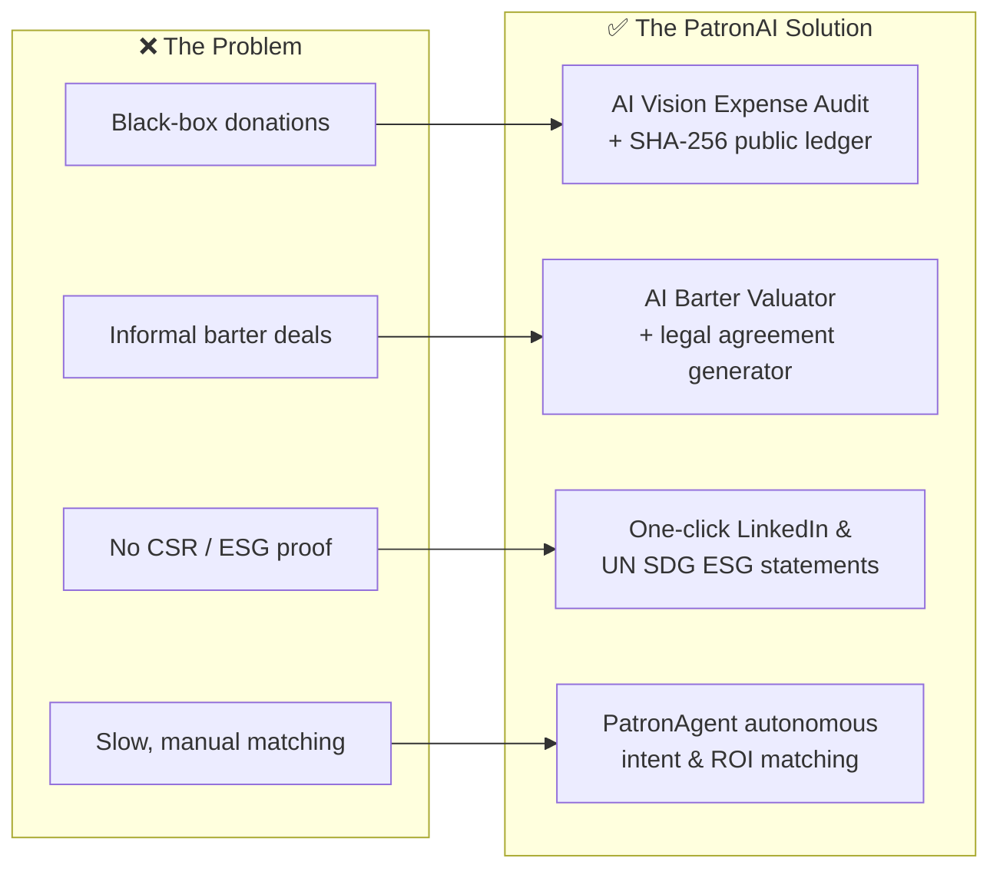
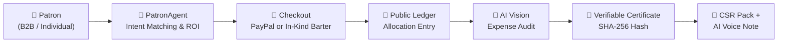
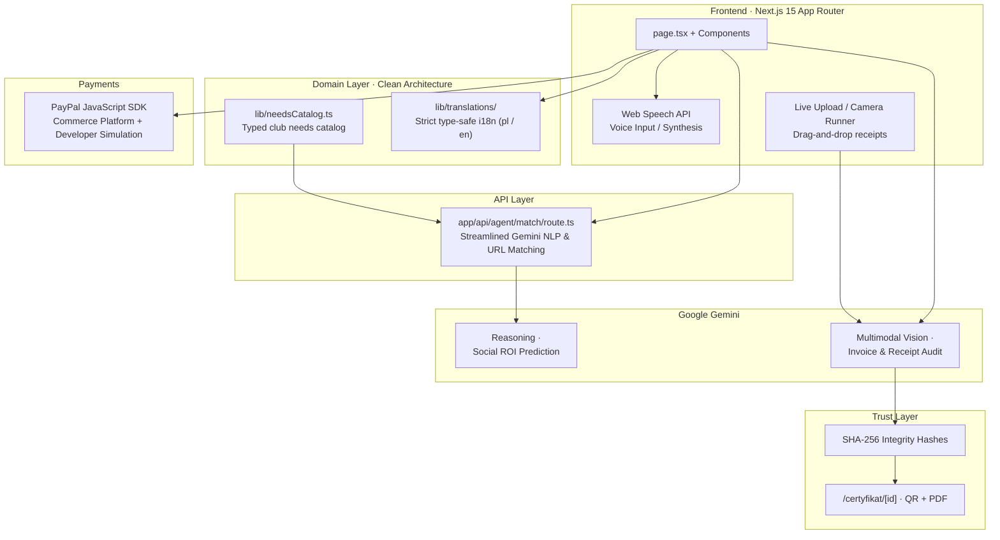
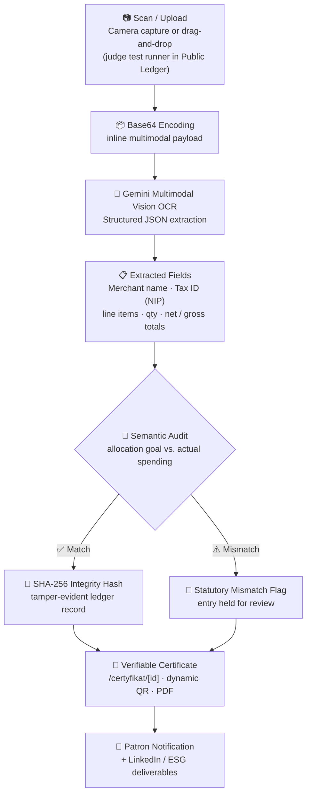

# ♟️ PatronAI — Agentic Patronage & Transparent AI Sponsorship for Youth Sports

> **Transforming corporate goodwill and community patronage into verified, verifiable impact for grassroots youth sports.**

[](https://nextjs.org/)
[](https://www.typescriptlang.org/)
[](https://tailwindcss.com/)
[](https://ai.google.dev/)
[](https://developer.paypal.com/)
[](https://opensource.org/licenses/MIT)

---

## 📌 Submission Meta Links

| Resource                        | Link                                                                                   |
| ------------------------------- | -------------------------------------------------------------------------------------- |
| 🌐 **Live Application**         | `https://patronat.vercel.app/`                                                         |
| 💻 **Source Code Repository**   | `https://github.com/AdamBabinicz/patronat`                                             |
| 🎥 **Video Demo & Pitch**       | `https://youtu.be/dQw4w9WgXcQ`                                                         |
| 🏆 **Target Pilot Partner** | **UKS Roszada Radom** — Youth Chess Club, Poland — prospective pilot partner / target community use case (80+ players); production deployment planned after the hackathon ([club profile](https://roszada.pl)) |

---

## 📖 Table of Contents

1. [The Problem](#-the-problem)
2. [The Solution](#-the-solution-patronai)
3. [System Architecture](#️-system-architecture--pipeline-diagrams)
4. [Core AI Pillars — Deep Dives](#-core-ai-pillars--deep-dives)
5. [Technology Stack](#️-technology-stack)
6. [Project Architecture](#-project-architecture-clean-architecture)
7. [Getting Started Locally](#-getting-started-locally)
8. [Judge Walkthrough — Test in 3 Minutes](#-judge-walkthrough--test-in-3-minutes)
9. [Pilot Framework, Simulation Data & Target Club Partnership](#-pilot-framework-simulation-data--target-club-partnership)
10. [What Makes PatronAI Hack-Worthy](#-what-makes-patronai-hack-worthy--60-second-executive-summary)
11. [License & Team](#-license--team)

---

## 💡 The Problem

1. **Grassroots Sports Underfunding:** Local youth clubs operate with limited administrative resources, struggling to reach corporate sponsors and individual donors.
2. **The "Black Box" of Donations:** Sponsors hesitate to donate because traditional charity lacks granular transparency regarding how funds are actually spent — a transfer is made, and trust is asked for in return.
3. **Barter Inefficiencies:** A significant share of small-business support is provided in-kind (printing, transport, catering, equipment), yet clubs lack legal templates and market valuation tools to formalize informal barter agreements.
4. **Lack of Instant Corporate Return (CSR/ESG):** B2B patrons want measurable impact metrics for annual ESG reports and ready-to-publish social media deliverables — deliverables that usually take weeks of back-and-forth.

### Problem → Solution Mapping



---

## 🚀 The Solution: PatronAI

**PatronAI** is an autonomous agentic platform connecting patrons and businesses with youth sports needs — represented in this prototype by an **illustrative demo catalog** (`lib/needsCatalog.ts`). Powered by **Google Gemini multimodal intelligence** and agentic commerce workflows, PatronAI converts patron intentions into **audited, hash-verified allocations** (demonstrated on mock data) — with instant corporate deliverables (LinkedIn posts, ESG statements, certificates, and personalized voice thank-you notes) generated the moment a contribution is made.

The platform is a **Competition Pilot & Prototype**: **Real Funds Collected: 0.00 PLN** — no sponsorship revenue exists, and no production PayPal account is connected. The public ledger presents a **100% Hypothetical Demonstration Dataset of 19,945 PLN across 130+ mock allocations**: a modeled scenario based on illustrative club needs, created solely to demonstrate how the architecture works end-to-end. No real invoices, budgets, or club expenditures exist behind these numbers.

### End-to-End Patronage Flow



---

## 🏗️ System Architecture & Pipeline Diagrams

### High-Level System Flow



### AI Vision Expense Audit Pipeline

The pipeline runs **at allocation time, not upload time** — every receipt is semantically audited against the patron's declared goal before it can be marked as verified.



---

## 🧠 Core AI Pillars — Deep Dives

### 1. ⚡ PatronAgent — Autonomous Intent & ROI Matcher

PatronAgent is the agentic front door of the platform: it turns a raw intention into a structured, priced, impact-scored sponsorship in seconds.

- **Multimodal Input:** Accepts natural language descriptions, **voice input via the Web Speech API** (`pl-PL` / `en-US`), or a plain company URL (e.g. `drukarnia-virgo.pl`, `facebook.com`).
- **Automated URL Parsing & Domain Categorization:** The `app/api/agent/match/route.ts` Gemini-backed endpoint scrapes and classifies the business domain, determining whether the patronage is financial or in-kind — no forms, no onboarding friction.
- **Needs-Catalog Matching:** Domain logic is decoupled into `lib/needsCatalog.ts` — a strictly typed catalog of **illustrative club needs** (equipment, transport, tournaments, coaching): hypothetical demo scenarios the agent matches intentions against in this prototype.
- **Social ROI Predictor:** Forecasts measurable societal impact per allocation: beneficiary count, training hours funded, competition access percentage.
- **Adaptive Multi-Currency Engine:** Instant live switching with localized presets across **PLN**, **EUR**, and **USD** — sponsors see amounts in their own currency without page reloads.

### 2. 🧾 AI Vision Expense Audit — Live Ledger Verification

The flagship answer to the black-box donation problem, integrated directly in `components/PublicLedger.tsx`.

- **Gemini Multimodal Vision OCR:** Reads scanned VAT invoices and receipts, extracting the **Merchant Tax ID (NIP)**, invoice line items, and net/gross totals into structured JSON.
- **Semantic Purpose Verification:** Cross-checks what was purchased (e.g. _DGT electronic tournament clocks_, _championship bus transit_, _engraved trophies_ — **hypothetical test scenarios** with sample demo invoices) against the patron's original allocation goal — mismatches are **flagged, not silently approved**.
- **🖼️ Live Upload / Camera Test Runner:** Built for hackathon judges — drag-and-drop (or camera-capture) your own receipt and watch instant AI OCR verification happen live in the Public Ledger.
- **Tamper-Evident Cryptographic Ledger:** Every verified allocation is sealed with a **SHA-256 integrity hash**, making the public ledger tamper-evident down to individual line items.

### 3. 🤝 AI Barter Valuator — In-Kind Sponsorship Rails

Most sponsorship platforms ignore barter entirely. PatronAI makes in-kind contribution a first-class, certificate-grade citizen.

- **Automatic Market Valuation (AVE):** Values goods and services at market equivalence — transport, printing, trophies, IT support, catering.
- **Automatic Tier Allocation:** Classifies patrons into **Gold, Silver, and Bronze In-Kind Patron** tiers based on evaluated market value.
- **Legally Structured Agreement Generation:** Automatically generates downloadable, print-ready **Barter Partnership Agreements** (`.txt`) covering the in-kind contribution and the club's reciprocal commitments (banner exposure, social media spotlight, ledger certificate).

### 4. 💼 B2B CSR & ESG Pack + LinkedIn Viral Generator

Closes the corporate feedback loop in the same minute the contribution happens — not a quarter later.

- **One-Click LinkedIn Announcement:** A ready-to-publish post highlighting the funded need, club name, allocation amount, hashtags, and the public ledger link — engineered for shareability.
- **Formal ESG / SDG Statement:** Auto-formulated corporate sustainability language aligned with **UN SDG 3 (Good Health & Well-being)** and **UN SDG 4 (Quality Education)**, ready to paste into annual ESG and CSR reports.

### 5. 🎙️ AI Dynamic Impact Voice — Personalized Athlete Audio Note

The emotional payload of every sponsorship: donors don't just see a receipt — they _hear_ the impact.

- **Personalized Speech Synthesis:** A spoken thank-you note from junior club players, addressing the patron **by name**, generated via browser Speech Synthesis.
- **Interactive Equalizer Waveform:** A live visual audio waveform pulsing synchronously with playback (Canvas API).
- **Real-Time Bilingual Transcript:** Full on-screen transcription with seamless `pl` / `en` language support.

### 6. 🔐 Standalone Verification Route — `/certyfikat/[id]`

- **Public Immutable Verification Page:** Any certificate is independently verifiable at a standalone URL — no login, no app context required.
- **Dynamic QR Code:** Instant smartphone scanning straight from the certificate page or printed material.
- **PDF Generation & Ledger Lookup:** One-click PDF export and a direct link back to the tamper-evident public ledger entry.

### 7. 💳 PayPal Commerce Platform Integration

- **PayPal JavaScript SDK:** Supports card and digital wallet payments through the PayPal Commerce Platform.
- **Developer Simulation Mode:** A built-in simulation flow (`NEXT_PUBLIC_PAYPAL_CLIENT_ID=test`) lets judges trigger instant checkouts and explore post-payment deliverables without live credentials.
- **Sandbox-Only Status:** The gateway runs exclusively in **simulation / sandbox mode — no production UKS Roszada account connected**. No real transactions have been (or can be) processed at this stage of the project.

---

## 🛠️ Technology Stack

| Layer                       | Technologies                                                                                   |
| --------------------------- | ---------------------------------------------------------------------------------------------- |
| **Frontend Framework**      | Next.js 15 (App Router), React 19, TypeScript 5                                                |
| **Styling & UI**            | Tailwind CSS 3.4, Lucide Icons, Canvas API (audio equalizer)                                   |
| **Artificial Intelligence** | Google Gemini API (Multimodal Vision + Reasoning), Web Speech API (input & synthesis)          |
| **Payments & Checkout**     | PayPal JavaScript SDK (Commerce Platform, Sandbox / Developer Simulation Mode)                 |
| **Domain & i18n**           | `lib/needsCatalog.ts` (typed needs domain), `lib/translations/` (strict type-safe `pl` / `en`) |
| **Security & Trust**        | SHA-256 cryptographic integrity hashes, standalone QR verification route                       |
| **State & Storage**         | React State, LocalStorage (theme & language persistence)                                       |
| **Deployment**              | Vercel / Google Cloud Run (Dockerized Container)                                               |

---

## 📁 Project Architecture (Clean Architecture)

Domain logic is deliberately decoupled from the UI and API layers: the club needs catalog lives in `lib/needsCatalog.ts`, the Gemini orchestration is consolidated into a single streamlined route, and all user-facing strings flow through a strict, type-safe translation layer.

```bash
patronai/
├── app/
│   ├── api/
│   │   └── agent/
│   │       └── match/
│   │           └── route.ts         # Streamlined Gemini NLP & company-URL matching engine
│   ├── certyfikat/
│   │   └── [id]/
│   │       └── page.tsx             # Standalone verifiable certificate route (QR + PDF + ledger lookup)
│   ├── layout.tsx                   # Root layout with responsive viewport & meta
│   └── page.tsx                     # Main interactive application & navigation
├── components/
│   ├── PatronAgent.tsx              # AI matching, voice input & Barter Valuator
│   ├── DonationCheckout.tsx         # Multi-currency checkout & PayPal integration
│   ├── PublicLedger.tsx             # Real-time ledger with AI Vision Invoice Audit + live upload runner
│   └── checkout/
│       ├── AmountSelector.tsx       # Currency-adaptive donation tier pills
│       ├── DonorDetailsForm.tsx     # Anonymous / corporate patron details form
│       ├── DonationCertificate.tsx  # Certificate, AI Voice note & CSR pack
│       └── types.ts                 # TypeScript currency & allocation interfaces
├── lib/
│   ├── needsCatalog.ts              # Domain layer: typed club needs catalog (decoupled core logic)
│   └── translations/
│       ├── index.ts                 # Localization manager (strict, type-safe)
│       ├── pl.ts                    # Polish translation dictionary
│       └── en.ts                    # English translation dictionary
└── public/                          # Static branding & assets
```

---

## ⚡ Getting Started Locally

### Prerequisites

- Node.js 18.x or higher
- npm or pnpm package manager

### 1. Clone the repository

```bash
git clone https://github.com/AdamBabinicz/patronat
cd patronai
```

### 2. Install dependencies

```bash
npm install
```

### 3. Configure environment variables

Create a `.env.local` file in the project root:

```env
# Google Gemini API Key — powers Multimodal Vision audit & PatronAgent matching
GEMINI_API_KEY=your_gemini_api_key_here

# PayPal Client ID — set to 'test' for the built-in developer simulation mode
NEXT_PUBLIC_PAYPAL_CLIENT_ID=test

# Application Base URL — used for certificate links & QR codes
NEXT_PUBLIC_APP_URL=http://localhost:3000
```

> **Note:** With `NEXT_PUBLIC_PAYPAL_CLIENT_ID=test`, checkout runs in **developer simulation mode** — payments are simulated instantly so you can test the full post-payment flow (certificate, CSR pack, AI voice note) without PayPal credentials.

### 4. Run the development server

```bash
npm run dev
```

Open [http://localhost:3000](http://localhost:3000) in your browser to experience PatronAI.

---

## 🧪 Judge Walkthrough — Test in 3 Minutes

> Every scenario below runs on the live app with **no setup required**. PayPal simulation mode is pre-configured.

### ⏱️ Minute 1 — PatronAgent: Autonomous Matching

1. Paste `https://drukarnia-virgo.pl` (or any company URL) into PatronAgent — or tap 🎤 and speak in Polish or English (`pl-PL` / `en-US`).
2. Watch automated domain parsing, business categorization, and the **Social ROI prediction** (beneficiaries, training hours, impact metrics).
3. Flip the currency toggle **PLN → EUR → USD** and see the presets re-localize instantly.

### ⏱️ Minute 2 — Checkout + Instant Deliverables

1. Proceed to checkout with the PayPal SDK (**simulation / sandbox mode** — no real charge, no production account connected) or toggle 🎁 **In-Kind / Barter**.
2. In barter mode, watch the **AI Barter Valuator** assign a Gold/Silver/Bronze tier from the market valuation (AVE) and download the print-ready **`.txt` Barter Partnership Agreement**.
3. After "payment," open the delivered **AI PR Kit**: the one-click LinkedIn announcement and the UN SDG 3/4-aligned ESG statement.
4. Play the **AI Dynamic Impact Voice** note — a personalized spoken thank-you from the junior players, with the live equalizer waveform and bilingual transcript.

### ⏱️ Minute 3 — AI Vision Expense Audit & Verification

1. Scroll to **KROK 03 · Public Ledger** and click 🧾 **Audyt AI / AI Audit** on any allocation row.
2. Inspect the Gemini-extracted VAT invoice data: merchant **NIP**, line items, net/gross totals — semantically checked against the allocation goal.
3. **Try it yourself:** use the **Live Upload / Camera runner** to drag-and-drop your own receipt and watch instant AI OCR verification.
4. Open any **`/certyfikat/[id]`** certificate: scan the dynamic QR code with your phone, verify the SHA-256 hash, and export the PDF.

---

## 📊 Pilot Framework, Simulation Data & Target Club Partnership

PatronAI is a **competition prototype / pilot** prepared for the PayPal AI Hackathon — for full transparency with the jury, here is exactly what is real today and what is simulated:

**1. 🏁 Competition status — Real Funds Collected: 0.00 PLN.** This is a competition demonstration prototype: no real funds have been raised, and the club's production PayPal account (UKS Roszada Radom) is **not connected** — all checkout flows run in PayPal developer **simulation / sandbox mode, no production UKS Roszada account**.

**2. 📈 100% Hypothetical Demonstration Dataset — 19,945 PLN and 130+ allocations.** Every figure in the public ledger (amounts, invoices, receipts) is **mock demo data**: a modeled scenario based on illustrative club needs, created solely to demonstrate the matching → payment → audit → certificate pipeline end-to-end. **No real invoices, budgets, or club expenditures exist behind these numbers.**

**3. 🤝 Target pilot club — UKS Roszada Radom (80+ children).** A real local club designated as the **prospective pilot partner / target community use case** for production deployment after the hackathon; the current implementation is a prototype powered entirely by sample demo data.

| Metric (demonstration prototype) | Value                                                                                                |
| -------------------------------- | ---------------------------------------------------------------------------------------------------- |
| 💰 **Real Funds Collected**      | **0.00 PLN** — competition prototype demo; the ledger's 19,945+ PLN is mock data                      |
| ✅ **Audited Allocations**       | **130+ synthetic mock entries** — hypothetical test scenarios for the Gemini OCR audit                |
| 🧾 **Needs & Invoices**          | **100% hypothetical test scenarios** (chess clocks, entry fees, transport) used to exercise the Gemini OCR audit |
| ♟️ **UKS Roszada Radom**         | **Target pilot club (80+ players)** — prospective pilot partner / target community use case; production deployment planned after the hackathon |

**What this demonstrates:** the agentic workflow — matching → payment → audit → certificate — is a modeled scenario based on illustrative club needs, ready to be connected to a real club (UKS Roszada Radom) after the competition.

---

## 🌟 What Makes PatronAI Hack-Worthy — 60-Second Executive Summary

- **🧾 Truly Agentic Vision Audit, not a buzzword.** Gemini Multimodal Vision runs at allocation-time, not upload-time: every receipt is parsed into structured JSON (product · quantity · gross total · NIP) and semantically cross-checked against the patron's declared goal — mismatches are flagged, never silently approved. The first honest answer to the _black-box donation problem_.
- **🤝 Beyond cash: in-kind barter as a first-class citizen.** The AI Barter Valuator assigns AVE market equivalence, picks a Gold/Silver/Bronze tier, and generates a downloadable, legally structured partnership agreement — turning a coach bus or a printed banner into a trackable, certificate-grade contribution.
- **📣 Instant corporate deliverables.** One-click LinkedIn posts + UN SDG-aligned ESG statements the same minute the patron checks out — closing the CSR feedback loop that normally takes a quarter.
- **🎙️ Emotional impact, engineered.** A personalized spoken thank-you from the athletes themselves, with a live equalizer waveform — sponsors don't just read a receipt, they _feel_ the impact.
- **🔐 Tamper-evident, not just "transparent."** Every ledger entry carries a SHA-256 hash and a standalone `/certyfikat/[id]` verification page with dynamic QR + PDF export — sponsors audit individual line items, not trust an aggregate dashboard.
- **🧪 Transparent competition pilot, not inflated traction.** Real funds collected: **0.00 PLN** (PayPal runs in sandbox / developer simulation mode, no production UKS Roszada account); the ledger's 19,945 PLN and 130+ allocations are a **100% Hypothetical Demonstration Dataset** — mock invoices built on illustrative club needs to showcase the architecture — with UKS Roszada Radom (80+ active youth players) named as the **prospective pilot partner / target community use case** for deployment after the hackathon.
- **🏛️ Clean Architecture that judges can read.** Domain logic decoupled into `lib/needsCatalog.ts`, one streamlined Gemini orchestration route, and strict type-safe i18n — a codebase built to scale past the hackathon.

---

## 📄 License & Team

This project is licensed under the [MIT License](https://opensource.org/licenses/MIT).

### 👥 Team

| Role                                      | Name / Contact                                                |
| ----------------------------------------- | ------------------------------------------------------------- |
| **Lead Architect & Full-Stack Developer** | **Adam Gierczak** ([GitHub](https://github.com/AdamBabinicz)) |

> Built for the **PayPal AI Hackathon** — with gratitude to **UKS Roszada Radom** (players, parents, and coaches), our prospective pilot partner / target community use case, whose deployment is planned after the competition. ♟️
